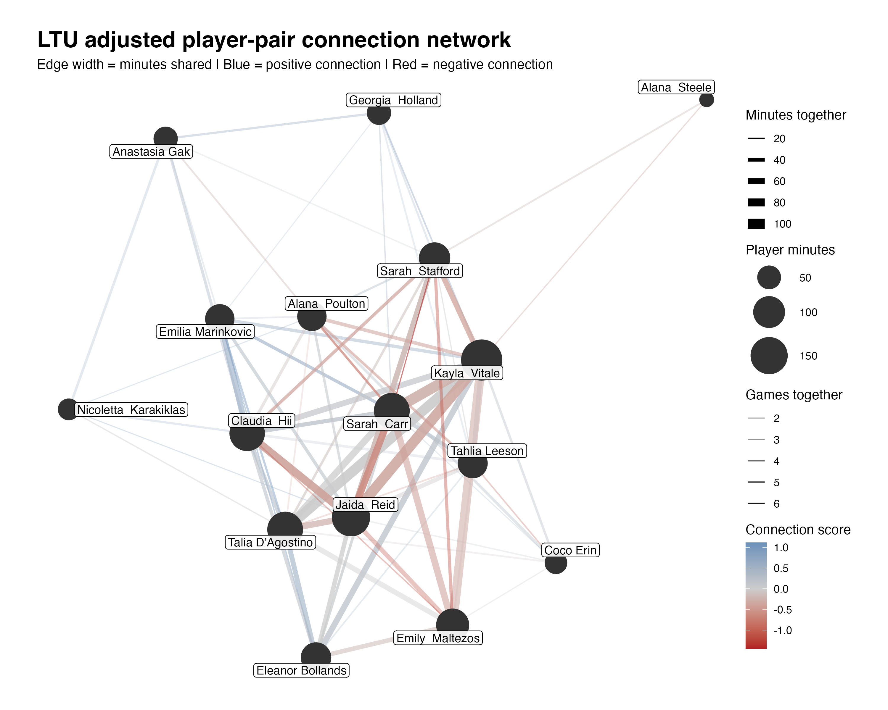

# LTU basketball: player connections and rotation analysis

This project explores player-pair performance and rotation patterns for La Trobe University (LTU) in the 2025 University Basketball League (UBL) women's competition season.

The analysis reconstructs on-court lineups from play-by-play events, estimates regularised adjusted plus-minus (RAPM) ratings, and calculates player-pair connection scores. It also examines rotation networks, tests whether connection scores improve held-out game predictions, and compares women's and men's league results using team-level networks.

Connection scores describe performance above or below the model's prediction during shared court time. They are associations and should not be interpreted as proof of player chemistry or causal effects.

## Project structure

| File or folder | Purpose |
| --- | --- |
| `R/LTU-team.R` | 	Loads saved women's fixtures and LTU events, reconstructs lineups, fits the season model, and calculates pair scores, stability, minutes, centrality and situational summaries |
| `R/LTU-prediction.R` | Evaluates baseline and pair-adjusted predictions using leave-one-game-out validation |
| `R/LTU-network-by-game.R` | Plots within-game pair residuals using the common season-model baseline |
| `R/LTU-league-comparison.R` | Calculates women's and men's team eigenvector centrality scores and compares their distributions using the Gini coefficient |
| `run-analysis.R` | Runs the four analysis stages, saves the analysis snapshot and records session information |
| `data/DATA.md` | Documents the data sources, processing and limitations |
| `data/raw/LTU_women_inputs_2025.rds` | Saved women’s fixtures and LTU play-by-play inputs |
| `data/raw/UBL_men_results_2025.rds` | Saved men’s league results |
| `outputs/tables/` | Generated CSV tables |
| `Figures/` | Generated figures |
| `LTU_report_data.rds` | Saved analysis objects for use in reporting |
| `session-info.txt` | R version, platform and package information from the analysis run |
| `save-analysis-inputs.R` | Saves input snapshots from a completed analysis session; not required for routine reproduction |
| `REPRODUCIBILITY.md` | Instructions for preserving inputs, refreshing data and testing reproducibility |

## Requirements

The analysis requires R and the packages listed below. Once the packages and saved input files are available, the analysis can run without accessing the live feed.

Install the required packages once:

```r
install.packages(c(
  "httr", "jsonlite", "stringr", "purrr", "tidyr", "glmnet",
  "igraph", "ggraph", "ggplot2", "scales", "dplyr"
))
```

The interactive network is optional:

```r
install.packages("visNetwork")
```

Static plots can be produced without `visNetwork`.

## Run the analysis

Open `Basketball-Project.Rproj` in RStudio and restart R. From the project root, run:

```r
options(ltu.refresh_inputs = FALSE)
source("run-analysis.R")
```

The runner checks the required files and packages and parses the four scripts before starting the analysis. It then runs:

```r
source("R/LTU-team.R")
source("R/LTU-prediction.R")
source("R/LTU-network-by-game.R")
source("R/LTU-league-comparison.R")
```

The prediction and per-game network scripts use objects created by `LTU-team.R`, so run the team script first when working through those stages manually.

If a stage fails, resolve the error and rerun that stage and any dependent stages. Outputs already written are not rolled back. The runner updates the analysis snapshot and session information after all four stages finish successfully.

## Outputs

The scripts save:

- CSV tables in `Outputs/tables/`
- Figures in `Figures/`
- Analysis objects in `LTU_report_data.rds`
- Session information in `session-info.txt`


For example, read the pair connection table with:

```r
pairs <- read.csv(
  "outputs/tables/LTU_final_pair_connection_table.csv"
)
```

Include a generated figure in a Quarto document with:

```r

```

Inspect the saved analysis objects with:

```r
report_data <- readRDS("LTU_report_data.rds")
names(report_data)
```

## Methods

### Lineup reconstruction and quality checks

Play-by-play events and substitutions are used to reconstruct stints: continuous intervals with the same five-player lineup.

Games with reconstructed playing-time coverage below 50% are excluded. Stints shorter than 15 seconds are excluded from the regression.

The current analysis retains eight of ten LTU games. Two games were excluded after starting-lineup detection failed. Of the eight retained games, six have full 40-minute reconstructed coverage and matching point totals. The other two have approximately 79.0% and 84.5% coverage, with differences between reconstructed and play-by-play point totals.

Retaining a game does not mean its reconstructed lineups are fully correct. Review `Outputs/tables/LTU_reconstruction_checks.csv` before interpreting the results.

### Individual ratings and pair connection scores

The season model uses duration-weighted ridge regression, with player indicators and opponent-team effects. The regularisation parameter is selected using game-level cross-validation and the `lambda.1se` rule.

Each stint's residual is its observed net points per minute minus the model's prediction. A pair's connection score is the duration-weighted average residual across stints in which both players share the court.

Season pair summaries require at least 15 shared minutes across at least two games. Leave-one-game-out sign checks are used to classify pairs as stable positive, stable negative or uncertain. These labels describe consistency under the specified checks; they are not tests of statistical significance.

### Prediction evaluation

Leave-one-game-out validation holds out one game at a time. Models and connection scores are calculated from the remaining games.

The baseline prediction comes from the fitted RAPM model. The pair-adjusted prediction adds the mean training connection score across the lineup's ten player pairs. Pairs without a training score contribute zero to this adjustment.

Performance is compared using duration-weighted root mean squared error (RMSE). A shuffle benchmark uses 2,000 pooled-stint permutations.

The shuffle benchmark is exploratory because it ignores dependence between stints within the same game.

### Network analysis

Player networks describe shared court time and pair connection scores. Rotation-network centrality measures describe players' positions within the shared-minutes network; they do not directly measure playing ability.

Per-game connection plots use the season model and show pairs with at least two shared minutes in that game. These are descriptive, in-sample plots rather than held-out predictions.

Display game numbers follow fixture-ID ordering and may not be chronological. Players appear in every panel, including games in which they did not play.

The league comparison uses directed, margin-weighted edges from losing teams to winning teams. Eigenvector centrality summarises each team's position in that network. The Gini coefficient summarises inequality in those scores; it is a descriptive network measure rather than a complete measure of competitive balance.

For compatibility, the league tables retain the column name `eigenvector_centralization`, although each row contains an individual team's eigenvector centrality score.

## Data and reproducibility

The source data come from the UniSport/Sportradar feed. See
`data/DATA.md` for source details, snapshot provenance and limitations.

The analysis reads two saved input snapshots by default:

- `data/raw/LTU_women_inputs_2025.rds`
- `data/raw/UBL_men_results_2025.rds`

These files preserve the inputs used for the analysis without requiring
another download. The runner sets a random seed and regenerates the
tables, figures, analysis snapshot and session information.

Downloading updated source data is optional and may change the results.
See `REPRODUCIBILITY.md` for refresh instructions. Refreshing data is not
required to reproduce the saved-input analysis.

## Limitations

The analysis covers one LTU season with a small number of games. Important limitations include:

- Inferred starting lineups and potentially unlogged substitutions, including changes between quarters.
- Incomplete reconstructed coverage in two retained games.
- An assumed 40-minute regulation duration.
- Performance measured per minute rather than per possession.
- Limited ability to separate individual contributions when players frequently share the court.
- Pair scores that may reflect teammates, opponents and game situations as well as the pair itself.

Use the results to identify combinations and game periods for further review. More games and video validation are needed before using these scores to change rotations.


## Software and licence

The analysis uses R, `glmnet`, `igraph`, `ggraph`, `ggplot2` and tidyverse packages. Session details are recorded in `session-info.txt`.

Project code is provided under the MIT License; see `LICENSE`. Third-party data and assets remain subject to their respective terms.